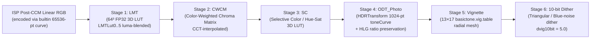

# OPPO Hasselblad Master Mode (`HNCS`) & Physical Optical Soft Light Pipeline (Directions 1 & 2 Archive)

> **Purpose**: Complete technical archive of Direction 1 (OPPO Find X9U / X8U / X7U Hasselblad Master Mode 6-stage pipeline + 8-family Master Color Engine) and Direction 2 (Scene-Linear Physical Optical Soft Light & Halation Engine) from `oppo-camera-pipeline-whitepaper` and `OmniCam-Muse`, preserved for future `XDRemux` offline rendering modes.
>
> **Archived Reference Sources**: [`tools/oppo-master-softlight-ref/`](../../tools/oppo-master-softlight-ref/)

---

## Part I — Direction 1: OPPO Hasselblad Master Mode (`BasicTone` + `HNCS`)

### 1. Six-Stage Stock Master Mode Pipeline (`libbasictone.so` + `libhdrtransform.so`)

In OPPO Find X7 Ultra / X8 Ultra / X9 Ultra (`com.oplus.camera`), Hasselblad Master Mode (大师模式) processes frames through a 6-stage pipeline operating in **Display P3 / HLG** space:

#### Stage Details
1. **Input Encoding (`builtin` / `proproc` / `luxInverse`)**:
   - Full-resolution captures (`Path::Main`) and previews (`Path::Preview`) encode post-CCM linear RGB through a 65,536-entry `builtin` non-linear table (spanning ~11 stops, capped at `d.cap`).
   - When `trunc(luxindex) > 280` (`luxBlend = true`), the camera blends `builtin` with `proproc`; `luxInverse` (`64³ × 3` FP32 table) inverts this blended encoding at every LMT lattice node.
   - Thumbnails (`1280×960`, `Path::Thumbnail`) use the 65,536-entry `proproc` curve directly.
2. **Scene Front Stage (`scene.bin` / `makeFrontStage`)**:
   - Converts post-CCM camera linear RGB into **scene-linear ProPhoto RGB (D50)** ($18\%\text{ grey} = 0.18$) using the physical rear lens's Adobe Standard DCP profile:
     $$\mathbf{M}_{\text{toProPhoto}} = \mathbf{M}_{\text{ProPhoto}\to\text{XYZ(D50)}}^{-1} \cdot \mathbf{FM}(T_{\text{CCT}}) \cdot \mathbf{CCM}^{-1}$$
   - Interpolates `ForwardMatrix1` / `ForwardMatrix2` and `HueSatMap1` / `HueSatMap2` linearly in mireds ($1 / T_{\text{CCT}}$), then applies the 2D HSV `HueSatMap` (`dcpRgbToHsv` $\to$ bilinear hue/sat lookup $\to$ `dcpHsvToRgb`).
3. **Hasselblad Natural Colour Solution (`HNCS`, `hncs_engine.bin`)**:
   - Transforms scene-linear Display P3 / ProPhoto into white-balanced camera RGB using Planckian/CIE daylight locus white point $\mathbf{w}(T_{\text{CCT}})$ and Bradford chromatic adaptation (`cat(D65, white)`).
   - Maps into `HNCS` RGB ($\mathbf{M}_{\text{HNCS}\to\text{XYZ(D50)}}$ uses ProPhoto primaries with luma weights $k_R = 0.28804, k_G = 0.71188, k_B = 0.00009$).
   - Converts to normalized chromaticity $(Y, C_b / Y, C_r / Y)$ and samples a CCT-interpolated 2D chromaticity warping grid (`gw × gh × 2`) that performs Hasselblad's signature skin-tone and sky/foliage vector calibration.
   - Applies the 65,536-entry `film` S-curve ($x \mapsto \text{film}[x]^{2.2}$) per channel and transforms back to Display P3.
4. **Output Inversion into HLG LMT Domain (`invertOutput`)**:
   - Because `libhdrtransform.so` subsequently applies `toneCurve[1024]` on BT.601 luma of the HLG signal, the LMT baker uses 24-step bisection to solve for scale $s \in [0, 8]$ such that:
     $$\sum_{c \in \{R,G,B\}} w_{601,c} \cdot \text{toneCurve}\!\left(\lfloor 1023 \cdot \text{HLG\_OETF}(s \cdot T_c) \rceil\right) = \sum_{c \in \{R,G,B\}} w_{601,c} \cdot \text{sRGB\_OETF}(T_c)$$
   - This guarantees that after `libhdrtransform.so` runs, the final SDR base image matches the exact display-linear P3 target while preserving full HLG highlight headroom!
5. **Tone / Colour Decomposition & Blending (`blendWithStock`)**:
   - Decomposes both the custom `look` $64^3$ LUT and each stock `LMTLut0..5` table in linear HLG light into:
     - **Scalar Tone Curve** $T(Y_{\text{scene}})$: the neutral-axis response as a function of input scene luminance (never alters chromaticity).
     - **Chromatic Ratio** $\mathbf{C} = \mathbf{L}_{\text{linear}} / T(Y_{\text{scene}})$: carries hue, saturation, and colour-dependent brightness (Helmholtz–Kohlrausch effect).
   - Recombines via log-linear geometric interpolation:
     $$T_{\text{out}} = T_{\text{stock}}^{1 - w_{\text{tone}}} \cdot T_{\text{look}}^{w_{\text{tone}}}, \qquad \mathbf{C}_{\text{out}} = \mathbf{C}_{\text{stock}}^{1 - w_{\text{colour}}} \cdot \mathbf{C}_{\text{look}}^{w_{\text{colour}}}$$

---

### 2. Eight-Family Master Color Engine (`MCOLLOOK` Binary Formats)

`master_core.cpp` supports 8 distinct colour science families unified under the `MCOLLOOK` container:

| `kind` | Engine Family | Mathematical Pipeline |
| :--- | :--- | :--- |
| `0` / `9` | **Hasselblad `HNCS`** | CCT-interpolated camera matrix + 2D $(C_b/Y, C_r/Y)$ chromaticity grid + 65536-pt film curve |
| `1` | **Panasonic Lumix S9 PhotoStyles** | Dual-illuminant `cm1`/`cm2` $\to$ 2048-pt 1D shaper curve $\to$ Kelvin-blended `low`/`high` $33^3$ FP16 3D LUTs |
| `2` / `8` | **Spektrafilm Negative + Print** | Scene ProPhoto $\times \text{inScale} \to \gamma_{1.8} \to 65^3$ negative film LUT $\to$ CMY density $(2 - D_c)$ $\to 65^3$ print paper LUT |
| `3` | **Darktable Sigmoid** | Scene BT.2020 $\to$ per-channel generalized log-logistic sigmoid with hue preservation parameter |
| `4` | **Darktable AgX** | Scene BT.2020 $\to$ inset matrix $\to \log_2$ range `[black, white]` $\to$ toe/shoulder curve $\to$ outset matrix |
| `5` | **Darktable Filmic RGB** | Scene BT.2020 $\to$ rational spline filmic toe/linear/shoulder norm-preserving mapping |
| `7` | **Canon EOS R5 Picture Styles** | EOS R5 dual-illuminant matrix $\to$ 1024×324 integer recipe atlas + optional ICC profile (`inputCurves` + $G^3$ CLUT + `outputCurves`) |
| `10` | **Leica M9 CCD (`OffLineM9`)** | Dual-branch ($R \ge G$ vs $R < G$) $3\times 3$ Q16 integer matrix (`>> 16` floor) + 2048-byte `table2048` tone curve |
| `11` | **Fujifilm X-Trans V Bezier** | 13-segment cubic Bezier luma gain + $3\times 3$ matrix + 10-segment per-channel Bezier shaper + $17^3$ 3D LUT |
| `12` | **Adobe ACR3 / Basic Luma** | Hue-preserving luma transfer curve (sRGB / Rec.709 / power $\gamma$ / ACR3 standard curve) in Display P3 |

---

## Part II — Direction 2: Physical Optical Soft Light & Halation Engine (`soft_light.cpp`)

### 1. Physical Optics Formulation in Scene-Linear Light

Stock Meishe ProMist operates in display-encoded space and washes out midtones. `OmniCam-Muse`'s `soft_light.cpp` replaces the 3 soft-light levels in Master Mode with a physical-optics point-spread scatter computed in **true scene-linear light $E$**:
- **Level 1 (`type = 1`, 柔美)**: **Ricoh GR IIIx HDF (Highlight Diffusion Filter)** — fixed to the GR's 28mm lens geometry (`kHdfFocalMm = 28.0`), with **2.6× clipped light-source restoration** (`kSourceGain = 2.6`) so small specular light sources bloom into an even, saturated glow while the rest of the frame remains crystal clear (~20% scatter fraction).
- **Level 0 (`type = 0`, 朦胧)**: **Tiffen 1/4 Black Pro-Mist** — scales with physical lens 35mm focal length (`gFocalMm`), with wavelength-dependent RGB scatter weights and `transmission = {0.8187, 0.8181, 0.8187}`, `core = {0.6675, 0.6665, 0.6675}` (preserving shadow contrast while adding a pearlescent mist).
- **Level 2 (`type = 2`, 梦幻)**: **White Pro-Mist** — scales with focal length, `transmission = {1.0, 1.0, 1.0}`, `core = {0.7399, 0.7399, 0.7403}`, strong wide-angle veil (`L_7..L_10` pyramid levels).

### 2. Mathematical Pipeline

1. **Signal $\to$ Scene Light Decoding (`kSoftHlgToScene[1024]`)**:
   - Each pixel's HLG RGB is decoded to scene-linear light $I_c \in [0, 10.718]$ (`18% grey = 0.18`, sensor clip `kSoftSceneMax = 10.717966`) by inverting the Master pipeline's neutral axis (`soft_light_curve.h`).
2. **Clipped Light-Source Boost (Ricoh HDF only, `kSourceGain = 2.6`)**:
   - A light source clipped in Hybrid RAW is physically brighter than the sensor clip.
   - **Pyramid input boost (`boostClipped`)**: Over the top `0.5` stops below `kSoftSceneMax`, pixel energy entering the blur pyramid is linearly boosted in $\log_2$ up to $2.6\times$ at clip.
   - **Neighbourhood core gate (`coreGain`)**: At the pyramid level whose texel footprint matches `kSourceDeg = 0.1°` in front of the lens:
     $$k_{\text{gate}} = \text{clamp}\!\left(\text{round}\!\left(\log_2\!\left(\frac{f_{35\text{mm}}}{43.267} \cdot D_{\text{px}} \cdot 0.1^\circ \cdot \frac{\pi}{180^\circ}\right)\right), 1, L_{\text{built}}\right)$$
     where the local neighbourhood peak averages within `kSourceStops = 0.3` stops of clip, the unscattered core is also boosted up to $2.6\times$ so the subsequent soft shoulder flattens the clipped bulb interior into a seamless glow without expanding surface texture.
3. **13-Tap Downsample / 4×4 Tent Upsample Pyramid (`L_1 .. L_12`)**:
   - **Downsample (`PASS_DOWN`)**: 13 taps of $2\times 2$ box means with `BORDER_REFLECT`:
     - Center $(0,0)$ and 4 inner diagonals $(\pm 1, \pm 1)$: weight $0.125$ each ($5 \times 0.125 = 0.625$)
     - 4 axial taps $(\pm 2, 0), (0, \pm 2)$: weight $0.0625$ each ($4 \times 0.0625 = 0.250$)
     - 4 outer corners $(\pm 2, \pm 2)$: weight $0.03125$ each ($4 \times 0.03125 = 0.125$)
   - **Upsample (`tentAt`)**: Separable 4-tap tent kernel (`kTentEven = {1/16, 5/16, 7/16, 3/16}`, `kTentOdd = {3/16, 7/16, 5/16, 1/16}`).
4. **Focal-Length-Indexed Angular PSF Weights (`levelWeights`)**:
   - Computes focal length in pixels:
     $$\ell_2 = \log_2\!\left(\frac{f_{35\text{mm}}}{43.267} \cdot \sqrt{W^2 + H^2}\right)$$
   - Interpolates `soft_light_weights.h` (`15` rows from $\ell_2 = 9.0$ to $12.5$ in $0.25$-stop steps, shifting pyramid levels by $+1$ per focal length doubling beyond table end):
     $$E_{\text{out}, c} = \frac{\text{core}_c \cdot g_{\text{core}} \cdot I_c + \sum_{i=1}^{12} w_{c,i}(\ell_2) \cdot L_{i,c}}{\text{transmission}_c}$$
5. **Hue-Preserving Soft Shoulder & Re-Encoding (`shoulder` + `kSoftSceneToHlg[1024]`)**:
   - Above knee $0.8 \cdot E_{\max}$, peak channel $P = \max(E_R, E_G, E_B)$ is compressed via hyperbolic tangent while scaling all three channels equally so highlight halos retain the exact chromaticity of their light source:
     $$P_{\text{comp}} = E_{\text{knee}} + (E_{\max} - E_{\text{knee}}) \tanh\!\left(\frac{P - E_{\text{knee}}}{E_{\max} - E_{\text{knee}}}\right), \qquad E_c \leftarrow E_c \cdot \frac{P_{\text{comp}}}{P}$$
   - Finally re-encoded to HLG (`kSoftSceneToHlg`) and written back as a YUV delta into the 10-bit P010 buffer.
