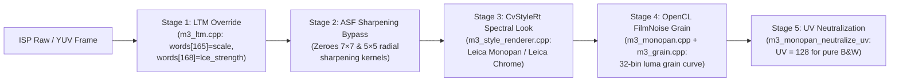

# Xiaomi 17 Ultra `LegendM3` Leica Classic M3 & `AUTHVignette` Shaders (Direction 3 Archive)

> **Purpose**: Complete technical archive of Direction 3 from `Prometheus-Camera` (`LegendM3`, `NaturalTuning`, `AUTHVignette`), preserved for future `XDRemux` offline rendering and film simulation modes.
>
> **Archived Reference Sources**: [`tools/xiaomi-m3-ref/`](../../tools/xiaomi-m3-ref/)

---

## 1. Xiaomi 17 Ultra `LegendM3` (`PhoenixM3`) Leica Classic M3 Architecture

In Xiaomi 17 Ultra (`P1`), the Leica M3 Classic Mode (`經典 M3`) is not a simple 3D LUT—it is a multi-stage hybrid ISP + OpenCL + `CvStyleRt` pipeline that emulates **Leica Monopan 50** black-and-white panchromatic film and **Leica Chrome** colour negative film.

### 1.1 Five-Stage Capture & Preview Pipeline



### 1.2 Key Algorithmic Parameters (`m3_monopan.cpp` & `m3_ltm.cpp`)

1. **OpenCL Monopan Film Grain Configuration (`M3MonopanConfig`)**:
   Extracted from Xiaomi 17 Ultra `libmialgo_filmnoise.so` (`VA 0x3320`, `0x4404`, `0x68ec`):
   - `iso_index = 20`
   - `grain_strength = 0.8f`
   - `grain_roughness = 0.3f`
   - `grain_size = 3` (`kernel_radius`)
   - `highlight_suppression = 0.2f`
   - `color_mode = 0` (monochrome grain)
   - **32-Entry Luminance-Dependent Grain Weight Curve (`luma_curve[32]`)**:
     ```c
     {0.098f, 0.114f, 0.129f, 0.153f, 0.176f, 0.204f, 0.231f, 0.255f,
      0.282f, 0.306f, 0.337f, 0.369f, 0.400f, 0.431f, 0.463f, 0.494f,
      0.525f, 0.557f, 0.588f, 0.620f, 0.651f, 0.682f, 0.710f, 0.741f,
      0.769f, 0.800f, 0.827f, 0.855f, 0.882f, 0.914f, 0.941f, 0.969f}
     ```
     Notice how the grain amplitude rises monotonically from `0.098` in deep shadows to `0.969` in upper midtones/highlights before `highlight_suppression = 0.2f` rolls off pure paper white.
2. **Local Tone Mapping (`m3_ltm_copy_region`)**:
   - Patches `M3LtmRegion::words[165]` (`scale_strength`) and `words[168]` (`lce_strength`) in the CamX LTM tuning payload to suppress digital HDR shadow lifting and local contrast halos during M3 capture.
3. **Xiaomi 18 Pro Max (`P2`) `NaturalTuning` De-Sharpening**:
   - Zeroes the CamX ASF (Adaptive Spatial Filter) radial lookup tables (`7×7` symmetric filter weights, `5×5` high-frequency boost, and edge-detection thresholds) so the optical lens MTF and physical film grain are never corrupted by digital halo ringing.

---

## 2. `AUTHVignette` Physical Shader Formulas (`addons/AUTHVignette/module/formulas/`)

### 2.1 Luminance-Aware Authentic Leica Optical Vignette (`original.glsl`)
Unlike a naive radial multiply `color * (1 - k * r^2)` which crushes bright skies into muddy grey corners, `original.glsl` computes a luminance-dependent protection weight $p = 100^{-(1 - Y)}$ where $Y = 0.2125 R + 0.7154 G + 0.0721 B$:

```glsl
vec3 factor = vec3(0.2125, 0.7154, 0.0721);
float Y = dot(vec3(color), factor);
uv.x = (uv.x - 0.5) * 0.75 + 0.5; // 4:3 aspect ratio compensation
float dist = distance(uv, vec2(0.5, 0.5));
float pow = 1.0 / pow(100.0, (1.0 - Y));
return color * (1.0 - pow) * smoothstep(smoothStartValue, falloff * smoothEndValue, dist * darkStrength)
     + color * pow;
```
- Bright highlights ($Y \to 1 \implies \text{pow} \to 1$) resist corner darkening, while midtones and shadows ($Y < 0.7 \implies \text{pow} \ll 1$) receive the full smoothstep radial falloff.

### 2.2 Lateral Chromatic Aberration (`chromatic.glsl`)
Simulates wide-angle rangefinder lateral chromatic dispersion toward frame corners using a 10-tap radial integral with cubic off-axis falloff $\|\mathbf{uv} - 0.5\|^3$:
- Red channel shifts by $1\times$ radial velocity, Green by $2\times$, Blue by $4\times$:
  $$\mathbf{v}(\mathbf{uv}) = \frac{\mathbf{uv} - 0.5}{\|\mathbf{uv} - 0.5\|} \cdot \text{blur} \cdot \|\mathbf{uv} - 0.5\|^3$$

### 2.3 Three-Ring CineStill 800T Anti-Halation Remjet Removal Shader (`cinestill-800t-halation.glsl`)
Simulates Kodak Vision3 500T film with remjet backing removed:
1. Decodes input sRGB to linear light ($\gamma = 2.2$) and extracts hot highlight energy above $Y = 0.48$ via Hermite `smoothstep(0.48, 1.0, Y)`.
2. Samples 3 concentric 8-tap rings (4 axial + 4 diagonal at $\cos 45^\circ = 0.7071$) with 4:3 aspect compensation `px = vec2(0.75, 1.0)`:
   - **Inner tight boundary reflection**: radius $r_1 = 0.0044$, weight $0.045$ per tap
   - **Middle film base substrate scatter**: radius $r_2 = 0.0115$, weight $0.052$ per tap
   - **Outer low-energy red tail**: radius $r_3 = 0.0250$, weight $0.028$ per tap
3. Subtracts the central highlight core (`halo = max(blurredHot - centerHot * 0.72, 0.0)`) so the halation forms a detached **ring/skirt** around bright light sources rather than blowing out the center, and adds the red-emulsion back-scatter spectrum $\mathbf{S}_{\text{halation}} = (1.0, 0.255, 0.055)$ in linear light before re-encoding to $\gamma_{1/2.2}$.
